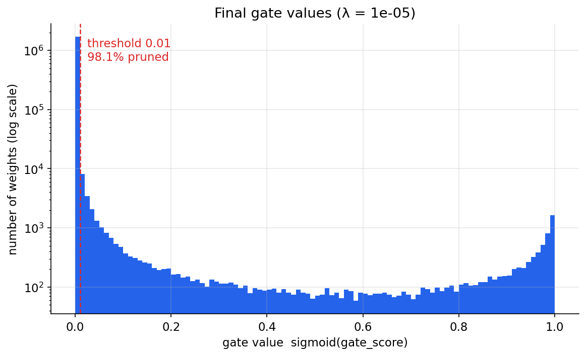
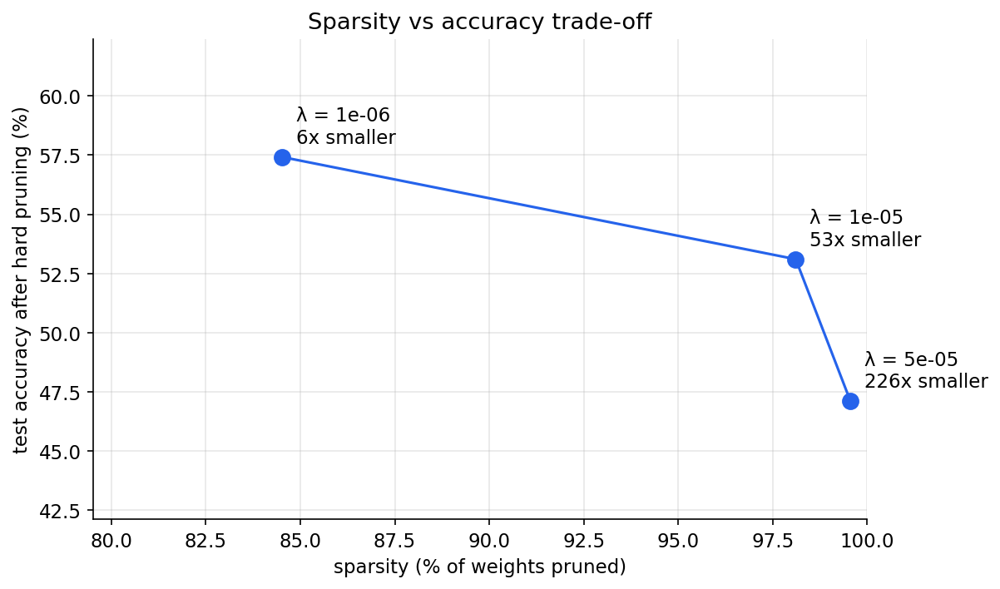
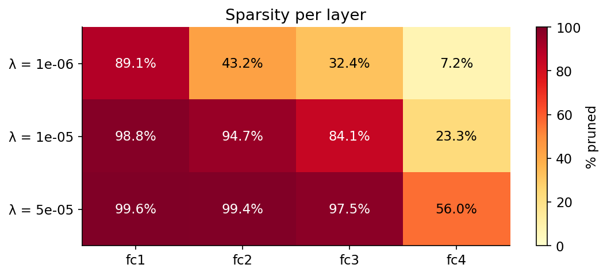

# Self-Pruning Neural Network

[](https://github.com/sarvesh-raam/self-pruning-neural-network/actions/workflows/ci.yml)
[](https://www.python.org/downloads/)
[](LICENSE)

A PyTorch feed-forward network for CIFAR-10 that **learns to delete its own weights during training**.
Every weight has a learnable sigmoid gate, and an L1 penalty on the gates pushes the unneeded ones to zero.
The result is a network with **98% of its weights removed that still reaches 53% test accuracy**,
stored in a 0.2 MB file instead of 7 MB.

**Live demo:** *(add your Hugging Face Space link here after deploying, see [Hosting](#hosting-the-demo))*

## Results

Three values of λ, 30 epochs each, same seed. Accuracy is measured **after hard pruning**: every gate below
0.01 is set to exactly 0, so the numbers describe the truly sparse network rather than a model whose
"pruned" weights still contribute a little.

| Lambda | Test Accuracy | Sparsity Level (%) | Weights kept | Compact model size |
|--------|---------------|--------------------|--------------|--------------------|
| 0 (no pruning, baseline) | 57.58% | 0.00% | 1,737,984 / 1,737,984 | 7 MB (dense fp32) |
| 1e-6 (low)    | **57.42%** | 84.52% | 269,027 / 1,737,984 (6.5x fewer) | 1.62 MB |
| 1e-5 (medium) | 53.10%     | 98.11% | 32,795 / 1,737,984 (53x fewer)   | 0.20 MB |
| 5e-5 (high)   | 47.11%     | 99.56% | 7,674 / 1,737,984 (226x fewer)   | 0.05 MB |

Accuracy before vs after hard pruning differs by less than 0.25 points for every λ
(57.40 → 57.42, 53.02 → 53.10, 46.87 → 47.11), so the removed connections really were unnecessary.
Full per-epoch output: [results/training_log.txt](results/training_log.txt).

| Gate distribution (λ = 1e-5) | Sparsity vs accuracy |
|---|---|
|  |  |

The histogram is the signature of a successful run: a spike of ~1.7M gates at 0 and a separate cluster of
surviving gates near 1, with very few in between. The y-axis is logarithmic; on a linear axis the
~33k survivors would be invisible next to the spike.



The 3072→512 input layer is pruned hardest: most raw pixel connections are redundant. The 10-way output
layer is pruned least, because every class needs some route to its logit.

**Analysing the trade-off.** Going from λ = 1e-6 to 1e-5 removes another 236k weights (84.5% → 98.1%) for a
4.3-point accuracy drop; going on to 5e-5 removes only 25k more but costs another 6 points. The curve
bends sharply near 98%: below that the network is shedding redundancy, above it it starts cutting
connections it actually uses. Against the unpruned baseline (λ = 0, 57.58%), the low-λ model gives up
just 0.16 points for a 6.5x reduction.

## How it works

### The prunable layer ([src/prunable_layer.py](src/prunable_layer.py))

`PrunableLinear(in_features, out_features)` holds `weight`, `bias` and a `gate_scores` tensor of the same
shape as `weight`, all registered as parameters:

```
gates          = sigmoid(gate_scores)          # each in (0, 1)
pruned_weights = weight * gates * mask
output         = x @ pruned_weights.T + bias
```

Because the product is built from ordinary tensor ops, autograd sends gradients to both `weight` and
`gate_scores` (verified in [tests/test_pruning.py](tests/test_pruning.py)). `mask` is a non-trainable
buffer: after training, `prune(threshold)` zeroes it wherever the gate is below the threshold.

### The loss

$$\mathcal{L}_{total} = \mathcal{L}_{CE}(y, \hat{y}) + \lambda \sum_{i} \sigma(g_i)$$

The gates are always positive, so their L1 norm is just their sum.

### Why an L1 penalty on the gates produces sparsity

The gradient of the penalty with respect to a gate is the constant λ, however small the gate already is.
Compare L2, whose gradient 2λg fades as g approaches 0, so L2 only shrinks values and never finishes the
job. Under L1 every gate feels the same steady pull towards 0. A gate stays open only if the
classification loss pushes back harder, i.e. if that connection measurably helps the prediction. The
connections that matter settle near 1 and the rest collapse to 0, which gives the two-cluster histogram
above. Raising λ raises the bar a connection has to clear, so more of them are cut.

### Three things that make it actually work

The first version of this project reported **0.00% sparsity for every λ**. Three problems caused that,
and fixing them is the core of the implementation:

1. **Gates need their own, higher learning rate.** Adam moves each parameter by roughly `lr` per step,
   whatever the gradient's size. At lr = 1e-3, closing a gate (score from +2 to below −4.6) would take
   more steps than an entire training run. Gates get lr = 0.05 in a separate optimizer group, while the
   weights keep 1e-3.
2. **No BatchNorm after gated layers.** BatchNorm rescales a layer's output, so the network could shrink
   *all* gates uniformly to satisfy the penalty while BatchNorm undid the effect. Gates fell, but nothing
   was really removed. Without it, shrinking a gate has a real cost and the optimizer must choose which
   connections to keep.
3. **Hard pruning before reporting.** A sigmoid never reaches exactly 0, so gates below the threshold are
   masked to exactly 0 and accuracy is measured again. Without this step the reported "sparse" accuracy
   can be optimistic.

λ is also ramped up linearly over the first 2 epochs, so the network learns useful features before
pruning pressure starts, and both learning rates follow a cosine schedule.

## Running it

```bash
git clone https://github.com/sarvesh-raam/self-pruning-neural-network.git
cd self-pruning-neural-network
pip install -r requirements.txt

python main.py --run_all                  # the three-λ comparison above (~15 min on a 6-core CPU)
python main.py --lambda_val 1e-5          # a single run
python main.py --lambdas 1e-6 3e-6 1e-5   # any set of λ values
python -m pytest -q tests                 # unit tests, synthetic data, no download
python app.py                             # local demo at http://127.0.0.1:7860
```

`python main.py --help` lists every option (epochs, learning rates, threshold, warm-up, seed, device).
Each run writes plots, `results.json`, `summary.md` and a full checkpoint to `results/`, plus a compact
sparse model to `models/`.

## Project structure

```text
├── src/
│   ├── prunable_layer.py   # PrunableLinear: gated weights + hard-prune mask
│   ├── model.py            # SelfPruningNet and the L1 sparsity loss
│   ├── train.py            # Trainer, in-memory CIFAR-10 loader, checkpoints
│   ├── export.py           # compact sparse export (int32 index + fp16 value per kept weight)
│   └── visualize.py        # all plots
├── experiments/run_all.py  # λ sweep, summary table, comparison plots
├── tests/                  # gradient flow, pruning, export round-trip, end-to-end sparsity
├── app.py                  # Gradio demo
├── scripts/                # Hugging Face deploy, demo example images
├── models/                 # compact pruned models used by the demo
├── results/                # plots, results.json, training log
├── notebooks/analysis.ipynb
└── main.py                 # CLI entry point
```

## Hosting the demo

The demo in [app.py](app.py) runs on a free CPU Hugging Face Space and needs only the compact models.

```bash
pip install huggingface_hub
hf auth login          # paste a token with write access
python scripts/deploy_space.py --space <your-hf-username>/self-pruning-neural-network
```

To redeploy automatically on every push, add the `HF_TOKEN` secret and an `HF_SPACE` variable to the GitHub
repository (Settings → Secrets and variables → Actions). See [.github/workflows/deploy-space.yml](.github/workflows/deploy-space.yml).

## Limitations and next steps

- **An MLP on CIFAR-10 tops out around 55–60%.** The point here is the pruning mechanism, not the
  accuracy. A prunable `Conv2d` would bring the same idea to an architecture that reaches 90%+.
- **Unstructured sparsity saves memory, not time.** Individual zeroed weights shrink storage (226x here)
  but dense matrix multiplication does not speed up. Gating whole neurons or channels (structured
  pruning) would turn the sparsity into real inference speed-ups.
- **λ was chosen by looking at test accuracy.** A proper study would tune it on a validation split held
  out from the training set.
